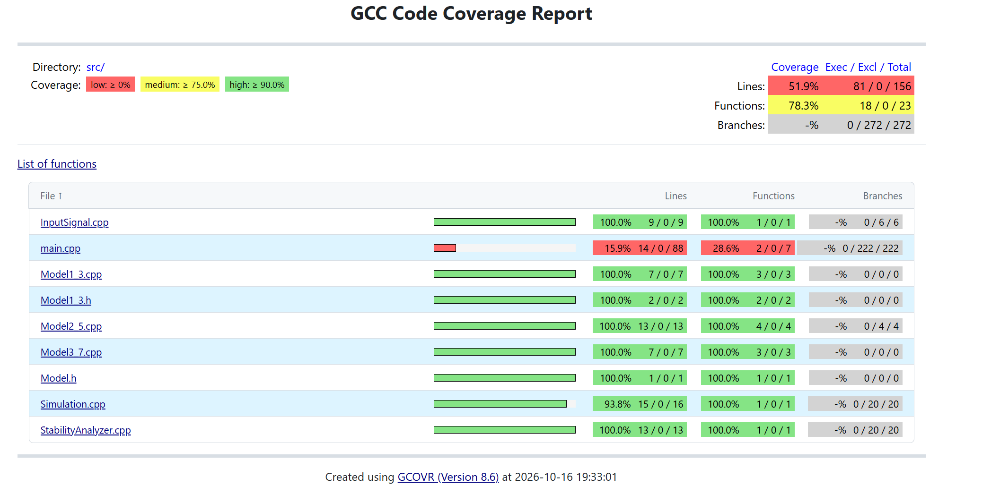

<p align="center"> Министерство образования Республики Беларусь</p>
<p align="center">Учреждение образования</p>
<p align="center">“Брестский Государственный технический университет”</p>
<p align="center">Кафедра ИИТ</p>
<br><br><br><br><br><br><br>
<p align="center">Лабораторная работа №2</p>
<p align="center">По дисциплине “Общая теория интеллектуальных систем”</p>
<p align="center">Тема: “Модульные тесты”</p>
<br><br><br><br><br>
<p align="right">Выполнил:</p>
<p align="right">Студент 2 курса</p>
<p align="right">Группы ИИ-30</p>
<p align="right">Поляк В. В.</p>
<p align="right">Проверил:</p>
<p align="right">Дворанинович Д. А.</p>
<br><br><br><br><br>
<p align="center">Брест 2026</p>


# OTIS — лабораторная работа №2

**Вариант:** 3  
**Предыдущая работа:** лабораторная работа №1  
**Язык:** C++17  
**Тестовый фреймворк:** Google Test и Google Mock

## 1. Цель работы

Расширить программу из лабораторной работы №1 модулем анализа устойчивости линейной дискретной модели и обеспечить автоматическую проверку математических функций с помощью модульных тестов. Сборка, запуск тестов и подготовка отчётов выполняются локально с помощью CMake и `run_tests.bat`.

## 2. Математические модели варианта

В проекте сохранены три модели из лабораторной работы №1:

| Модель | Тип | Уравнение |
|---|---|---|
| Model 1.3 | Линейная дискретная модель второго порядка | `y[k+1] = a1*y[k] + a2*y[k-1] + b*u[k]` |
| Model 2.5 | Нелинейная дискретная модель | `y[k+1] = a*y[k] + b*sign(u[k])*(1 - exp(-abs(u[k])))` |
| Model 3.7 | Дифференциальная модель, рассчитываемая методом Эйлера | `y[k+1] = y[k] + dt*(-exp(a)*y[k] + b*u[k])` |

Поддерживаются три входных сигнала:

- **Step** — постоянный ступенчатый сигнал;
- **Impulse** — импульс в начальный момент, после которого вход равен нулю;
- **Harmonic** — гармонический сигнал `A*sin(k)`.

Программа рассчитывает значения модели по шагам, выводит результаты и сохраняет данные в CSV для построения графика.

## 3. Анализ устойчивости Model 1.3

Для анализа устойчивости рассматривается свободный процесс, то есть `u[k] = 0`:

`y[k+1] = a1*y[k] + a2*y[k-1]`.

Подстановка решения вида `y[k] = C*z^k` даёт характеристическое уравнение:

`z^2 - a1*z - a2 = 0`.

Корни вычисляются по формуле:

`z1,2 = (a1 ± sqrt(a1^2 + 4*a2)) / 2`.

Дискретная линейная модель асимптотически устойчива, если оба корня строго лежат внутри единичной окружности:

`abs(z1) < 1` и `abs(z2) < 1`.

Граничный случай `abs(z) = 1` не считается асимптотической устойчивостью. Анализатор обрабатывает действительные и комплексные корни, а также отклоняет не конечные коэффициенты. Перед запуском симуляции Model 1.3 программа выводит найденные корни и предупреждение, если модель неустойчива.

Анализатор предназначен только для Model 1.3. Для Model 2.5 и Model 3.7 нужны отдельные критерии устойчивости.

## 4. Структура проекта

```text
task_02/
├── CMakeLists.txt
├── CMakePresets.json
├── build.bat
├── run_tests.bat
├── run_tests.sh
├── README.md
├── doc/
│   └── readme.md              # описание лабораторной работы № 1
├── src/
│   ├── main.cpp               # пользовательский интерфейс и запуск
│   ├── Model.h                # базовый интерфейс модели
│   ├── Model1_3.h/.cpp        # линейная модель
│   ├── Model2_5.h/.cpp        # нелинейная модель
│   ├── Model3_7.h/.cpp        # дифференциальная модель
│   ├── InputSignal.h/.cpp     # входные сигналы
│   ├── Simulation.h/.cpp      # пошаговая симуляция
│   ├── StabilityAnalyzer.h/.cpp
│   ├── ApplicationLogic.h/.cpp
│   └── plot.py                # построение графика
└── test/
    ├── test_models.cpp
    ├── test_stability.cpp
    ├── test_main_input.cpp
    └── test_application_logic.cpp
```

### Назначение основных файлов

- `Model.h` — общий абстрактный интерфейс математической модели.
- `Model1_3.*`, `Model2_5.*`, `Model3_7.*` — реализации трёх моделей варианта.
- `InputSignal.*` — формирование входных сигналов.
- `StabilityAnalyzer.*` — расчёт корней характеристического уравнения и проверка устойчивости Model 1.3.
- `main.cpp` — ввод параметров, выбор модели, выполнение симуляции и сохранение результатов.
- `test/test_models.cpp` — тесты моделей и входных сигналов.
- `test/test_stability.cpp` — тесты анализатора устойчивости.
- `run_tests.bat` — автоматическая сборка, запуск тестов и генерация отчётов в Windows.

## 5. Сборка и запуск

### Требования

- CMake 3.16 или новее;
- компилятор C++ с поддержкой C++17;
- Git и доступ к GitHub при первой сборке, поскольку Google Test/Google Mock загружаются через CMake FetchContent;
- `gcovr` для формирования HTML/XML-отчёта покрытия (необязательно, но требуется для измерения покрытия указанным способом).

### Запуск в Windows

Из корневого каталога проекта выполните:

```bat
run_tests.bat
```

Скрипт настраивает CMake, компилирует проект, запускает CTest и сохраняет JUnit-отчёт. Если `gcovr` установлен и доступен через `PATH`, дополнительно создаются отчёты покрытия.

Установка `gcovr`:

```bat
py -m pip install gcovr
```

### Ручной запуск

```bat
cmake -S . -B build -DOTIS_BUILD_TESTS=ON -DOTIS_ENABLE_COVERAGE=ON
cmake --build build --config Debug
ctest --test-dir build --output-on-failure
```

## 6. Модульные тесты

Тесты находятся в `test/test_models.cpp` и `test/test_stability.cpp`.

| Группа | Проверки |
|---|---|
| Линейная модель 1.3 | Расчёт следующего состояния для нескольких наборов параметров с помощью параметризованного `TEST_P` |
| Названия моделей | Проверка названий моделей с matcher `HasSubstr` из Google Mock |
| Нелинейная модель 2.5 | Нулевое состояние при нулевом входе; симметрия нелинейной добавки для входов противоположного знака |
| Дифференциальная модель 3.7 | Проверка шага метода Эйлера и неизменности состояния при `dt = 0` |
| Входные сигналы | Ступенчатый, импульсный и гармонический сигналы |
| Анализ устойчивости | Устойчивые действительные корни, неустойчивый корень, граница `abs(z) = 1`, комплексные корни и бесконечный коэффициент |

**Количество тестовых запусков, предусмотренных текущими файлами: 17.** Параметризованный тест линейной модели запускается для четырёх наборов данных; вместе с остальными тестами в двух файлах предусмотрено 17 запусков. Фактическое число успешно пройденных тестов следует подтвердить запуском `run_tests.bat`.

Google Mock в текущей версии используется для matcher-проверки названий моделей. Отдельный mock-объект генератора входных сигналов не реализован; тесты режимов сигналов выполняются непосредственно на функции `getInput()`.

## 7. Тестовое покрытие и результаты

- **Способ запуска:** локальный скрипт `run_tests.bat`.
- **Всего предусмотрено тестовых запусков:** 37.
- **Успешно пройдено:** все.



`run_tests.bat` настраивает сборку с инструментированием покрытия и, если `gcovr` установлен и доступен через `PATH`, создаёт `coverage.html` и `coverage.xml`. После запуска внесите в таблицу фактические проценты из отчёта. Значения намеренно не подменены примерными числами из задания: до измерения указывать их было бы недостоверно.

## 8. Результаты и ограничения

Реализованы три математические модели, три типа входных сигналов, анализ устойчивости Model 1.3, модульные тесты Google Test, параметризованный тест `TEST_P` и локальный скрипт автоматизации.

Для полного подтверждения результата необходимо выполнить `run_tests.bat` в среде с установленным CMake и компилятором C++17, доступом к GitHub при первой загрузке Google Test и, для отчёта покрытия, установленным `gcovr`. До этого успешное прохождение тестов и процент покрытия считаются не подтверждёнными.
