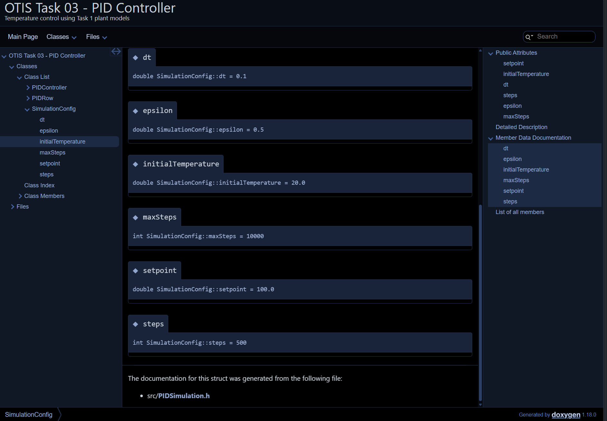
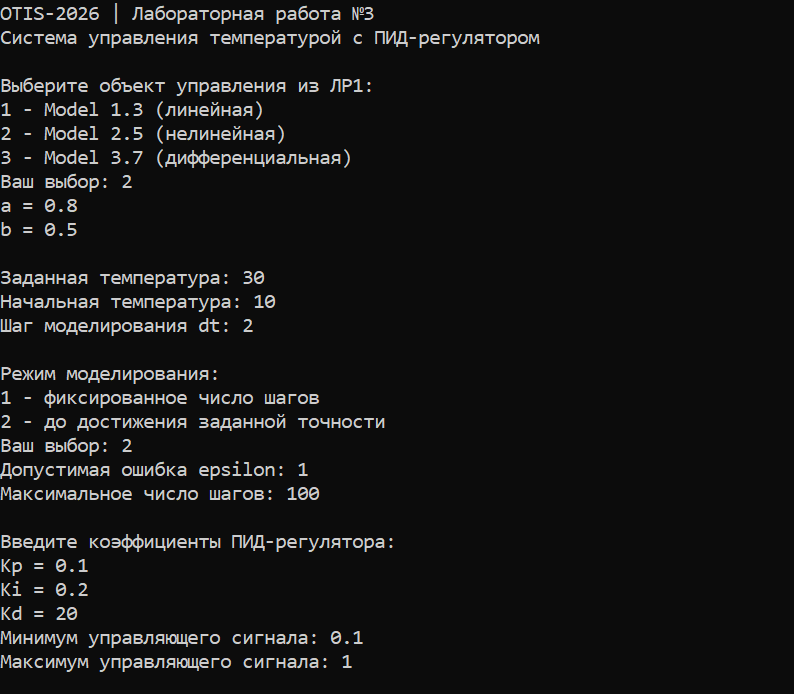
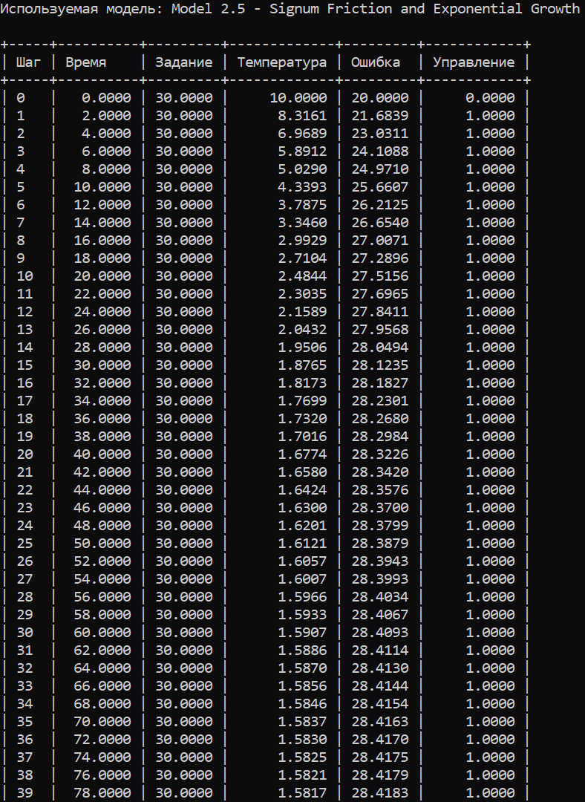
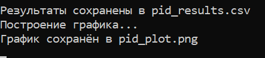
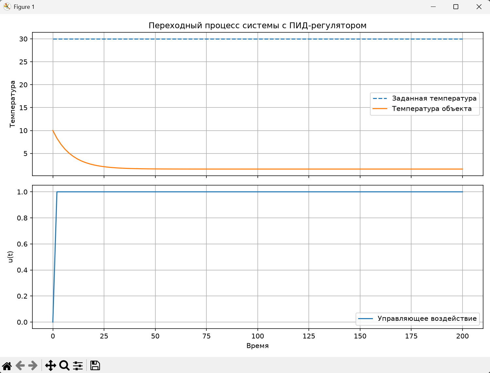

<p align="center">Министерство образования Республики Беларусь</p>
<p align="center">Брестский государственный технический университет</p>
<p align="center">Кафедра ИИТ</p>

<br><br>

<p align="center">Лабораторная работа №3</p>
<p align="center">По дисциплине «Общая теория интеллектуальных систем»</p>
<p align="center">Тема: «ПИД-регулятор системы управления температурой»</p>

<br><br>

<p align="right">Выполнил: студент 2 курса</p>
<p align="right">Группы ИИ-30</p>
<p align="right">Поляк В. В.</p>
<p align="right">Проверил: Дворанинович Д. А.</p>

<br><br>
<p align="center">Брест 2026</p>

# Лабораторная работа №3. ПИД-регулятор

## 1. Цель работы

Разработать программную модель замкнутой системы автоматического регулирования температуры с ПИД-регулятором. Использовать математические модели объекта управления, созданные в лабораторной работе №1. Реализовать два режима моделирования, сохранение результатов, графическую визуализацию, модульные тесты и автоматическую генерацию документации.

## 2. Модели объекта управления

В работе доступны три модели индивидуального варианта из ЛР1:

| Модель | Тип | Уравнение |
|---|---|---|
| Model 1.3 | Линейная | $y_{k+1}=a_1y_k+a_2y_{k-1}+bu_k$ |
| Model 2.5 | Нелинейная | $y_{k+1}=ay_k+b\,sign(u_k)(1-e^{-|u_k|})$ |
| Model 3.7 | Дифференциальная | $\dot y=-e^a y+bu$ |

Для Model 3.7 используется численное интегрирование методом Эйлера, реализованное в исходной лабораторной работе.

**Повторного копирования исходников нет.** CMake подключает заголовки и реализации моделей непосредственно из `../task_01/src`. Поэтому при размещении `task_03` рядом с `task_01` файлы моделей остаются единственными экземплярами.

## 3. Математическая модель ПИД-регулятора

Ошибка регулирования:

$$
e_k=r_k-y_k,
$$

где $r_k$ — заданная температура, $y_k$ — текущая температура объекта.

Интегральная составляющая:

$$
I_k=I_{k-1}+e_k\Delta t.
$$

Дифференциальная составляющая:

$$
D_k=\frac{e_k-e_{k-1}}{\Delta t}.
$$

Управляющее воздействие:

$$
u_k=K_pe_k+K_iI_k+K_dD_k.
$$

Физические ограничения исполнительного механизма:

$$
u_k=\min(u_{\max},\max(u_{\min},u_k)).
$$

В реализации предусмотрены ограничение интегральной суммы и anti-windup: интегральная составляющая не накапливается, если это усиливает насыщение исполнительного механизма.

На первом шаге производная принимается равной нулю, чтобы избежать резкого стартового скачка из-за отсутствия предыдущего измерения.

## 4. Режимы моделирования

### Режим 1 — фиксированное число шагов

Пользователь задаёт количество шагов $n$. Программа выполняет ровно $n$ итераций и формирует $n+1$ строк результата, включая начальное состояние объекта.

### Режим 2 — достижение заданной точности

Моделирование завершается, когда:

$$
|r_k-y_k|\leq\varepsilon.
$$

Пользователь задаёт допустимую ошибку $\varepsilon$ и максимальное число шагов. Максимальное число шагов необходимо для защиты от бесконечного моделирования, если выбранные коэффициенты регулятора не позволяют достичь требуемой точности.

## 5. Подбор коэффициентов регулятора

Коэффициенты $K_p$, $K_i$ и $K_d$ зависят от выбранной модели и её параметров. Поэтому они вводятся пользователем перед запуском симуляции.

Для начальной настройки применяется последовательный подбор:

1. Установить $K_i=0$, $K_d=0$. Постепенно увеличивать $K_p$, наблюдая за быстродействием и колебаниями.
2. Добавлять интегральную составляющую $K_i$, чтобы уменьшить статическую ошибку.
3. Постепенно добавлять $K_d$, чтобы уменьшить перерегулирование и колебательность.
4. Сравнивать переходные процессы при разных коэффициентах.
5. Проверить работу на нескольких значениях заданной температуры и при ограничениях управляющего сигнала.

Слишком большое $K_p$ может вызвать колебания, чрезмерное $K_i$ — накопление интегральной ошибки, а чрезмерное $K_d$ — чувствительность к шуму измерений.

## 6. Выходные данные

Для каждого временного шага сохраняются следующие величины:

| Столбец | Описание |
|---|---|
| `step` | Номер шага |
| `time` | Текущее время |
| `setpoint` | Заданная температура |
| `temperature` | Температура объекта |
| `error` | Ошибка регулирования |
| `control` | Управляющее воздействие |

Таблица выводится в консоль и записывается в `pid_results.csv`.

## 7. Графическая визуализация

Скрипт `src/plot.py` строит два графика:

- заданная и фактическая температура;
- управляющее воздействие ПИД-регулятора.

График сохраняется в `pid_plot.png`. Для сравнения нескольких заданных температур следует выполнить программу несколько раз, меняя значение задания, и сохранить CSV и изображения каждого запуска отдельно.

## 8. Модульное тестирование

Для тестирования используется Google Test. Тесты проверяют:

- пропорциональную реакцию регулятора;
- ограничение управляющего воздействия;
- отсутствие стартового дифференциального скачка;
- сброс внутреннего состояния;
- обработку некорректных параметров;
- фиксированный режим симуляции;
- режим остановки по заданной точности;
- возможность использования всех трёх моделей из ЛР1.

Запуск тестов:

```bash
ctest --test-dir build --output-on-failure
```

Google Test загружается CMake через FetchContent при первой конфигурации, поэтому для первой сборки требуется подключение к Интернету.

## 9. Документирование

Исходный код снабжён комментариями Doxygen. Конфигурация `Doxyfile` формирует HTML-документацию в каталоге `doc/html`.

Для генерации документации:

```bash
doxygen Doxyfile
```

Для просмотра откройте `doc/html/index.html`.


## 10. Автоматизация

Файл `run_all.bat` автоматизирует последовательность:

1. конфигурация проекта CMake;
2. сборка программы и тестов;
3. запуск Google Test;
4. генерация документации Doxygen.

Перед запуском необходимо установить CMake, компилятор C++, Doxygen и Graphviz. Для построения графиков требуется Python и библиотека Matplotlib.

Установка Matplotlib:

```bash
python -m pip install matplotlib
```

## 11. Структура проекта и повторное использование файлов

```text
trunk/ii03017/
├── task_01/
│   └── src/                 # модели, уже реализованные в ЛР1
├── task_02/
└── task_03/
    ├── CMakeLists.txt
    ├── Doxyfile
    ├── run_all.bat
    ├── src/
    │   ├── PIDController.h
    │   ├── PIDController.cpp
    │   ├── PIDSimulation.h
    │   ├── PIDSimulation.cpp
    │   ├── main.cpp
    │   └── plot.py
    ├── test/
    │   └── test_pid.cpp
    └── doc/
        └── readme.md
```


## Выполнение программы





## Вывод

В лабораторной работе разработана программная система автоматического регулирования температуры с ПИД-регулятором. Программа использует три модели объекта управления из ЛР1 без копирования исходных файлов, поддерживает два режима моделирования, ограничение управляющего сигнала и защиту интегральной составляющей от windup. Реализованы табличный вывод, экспорт результатов в CSV, построение графиков, модульные тесты Google Test и генерация HTML-документации Doxygen.
